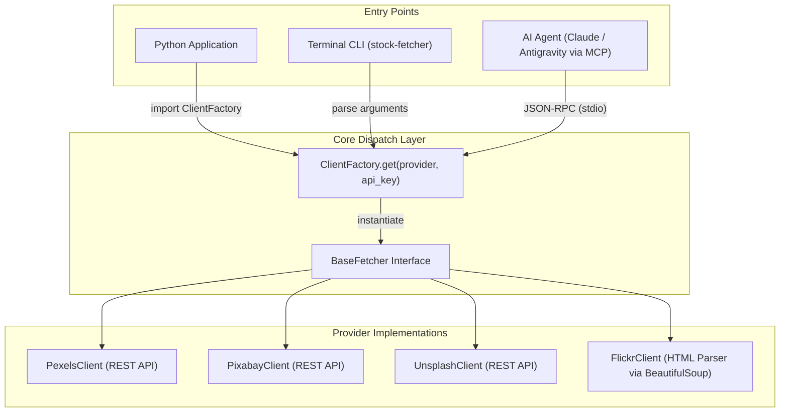
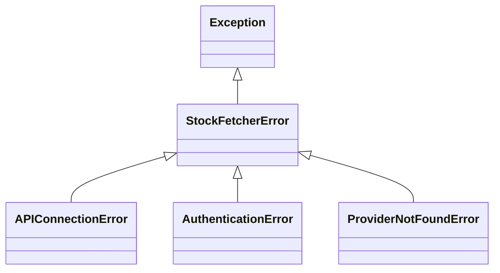

<p align="center">
  
</p>

# stock-fetcher

Unified Python client, CLI utility, and Model Context Protocol (MCP) server for retrieving copyright-free images from Pexels, Pixabay, Unsplash, and Flickr.

<p align="center">
  <a href="https://github.com/AtaCanYmc/stock-fetcher/actions/workflows/ci.yml">
    
  </a>
  <a href="https://opensource.org/licenses/Apache-2.0">
    
  </a>
  <a href="https://www.python.org/downloads/">
    
  </a>
  <a href="https://github.com/astral-sh/ruff">
    
  </a>
  <a href="https://modelcontextprotocol.io/">
    
  </a>
</p>

<p align="center">
  
</p>

---

## Table of Contents

- [Architecture](#architecture)
- [Supported Providers](#supported-providers)
- [Installation](#installation)
- [Quick Start](#quick-start)
- [CLI Interface](#cli-interface)
- [MCP Server for AI Agents](#mcp-server-for-ai-agents)
- [Environment Configuration](#environment-configuration)
- [Error Handling](#error-handling)
- [Legal & Licensing Terms](#legal--licensing-terms)
- [Technical FAQ](#technical-faq)

---

## Architecture

The diagram below illustrates the ingestion pipeline, interface entry points, factory routing, and provider dispatch mechanics:



---

## Supported Providers

| Provider | Access Mode | Auth Requirement | Environment Variable | Output Metadata |
| :--- | :--- | :--- | :--- | :--- |
| **Pixabay** | REST API | Required | `PIXABAY_API_KEY` | ID, source, thumbnail, preview, original URL, user |
| **Pexels** | REST API | Required | `PEXELS_API_KEY` | ID, source, thumbnail, preview, original URL, photographer |
| **Unsplash** | REST API | Required | `UNSPLASH_API_KEY` | ID, source, thumbnail, preview, original URL, description |
| **Flickr** | HTML Scraper | None | None | ID, source, thumbnail, original URL, title |

---

## Installation

### Core Package

Install the base library for programmatic Python access:

```bash
pip install stock-fetcher
```

For local repository development:

```bash
pip install -e .
```

### Optional Extras

Install additional capabilities using optional extras:

```bash
# Terminal CLI interface (Typer + Rich)
pip install "stock-fetcher[cli]"

# Model Context Protocol server for AI agent tool calling
pip install "stock-fetcher[mcp]"

# Both CLI and MCP interfaces
pip install "stock-fetcher[all]"

# Development dependencies (Ruff, Pre-commit, Build)
pip install -e ".[dev,all]"
```

---

## Quick Start

Instantiate provider clients using `ClientFactory.get`. The factory returns a client conforming to the `BaseFetcher` interface with a uniform `search(term, limit)` method.

### Programmatic Usage

```python
import os
from stock_fetcher import ClientFactory, StockFetcherError

# 1. Initialize client via factory
client = ClientFactory.get(
    provider="pixabay",
    api_key=os.getenv("PIXABAY_API_KEY", "")
)

# 2. Execute search query
try:
    images = client.search(term="alpine mountains", limit=3)
    for img in images:
        print(f"[{img['source']}] ID: {img['id']}")
        print(f"Original URL: {img['url_original']}")
        print(f"Webpage URL:  {img['url_page']}\n")
except StockFetcherError as exc:
    print(f"Fetch failed: {exc}")
```

### Zero-Config Scraping (Flickr)

Flickr scraping requires no external account or API key:

```python
from stock_fetcher import ClientFactory

flickr = ClientFactory.get("flickr")
images = flickr.search(term="classic vehicles", limit=2)

for item in images:
    print(f"Found: {item['title']} -> {item['url_original']}")
```

---

## CLI Interface

When installed with the `[cli]` extra, the package provides the `stock-fetcher` executable.

```bash
# Search Pixabay using an explicit API key flag
stock-fetcher search pixabay "desert landscape" --limit 3 --api-key "YOUR_KEY"

# Search Flickr using default environment configuration
stock-fetcher search flickr "urban architecture" --limit 5
```

For full CLI options, refer to the [CLI Manual](docs/cli_manual.md).

---

## MCP Server for AI Agents

When installed with the `[mcp]` extra, `stock-fetcher` runs as an MCP stdio server exposing the `search_images` tool to AI environments such as Claude Desktop and Google Antigravity.

Start the server process manually:

```bash
python -m stock_fetcher.mcp.server
```

Add the following definition to your agent MCP configuration:

```json
{
  "mcpServers": {
    "stock_fetcher": {
      "command": "python",
      "args": ["-m", "stock_fetcher.mcp.server"],
      "env": {
        "PEXELS_API_KEY": "YOUR_PEXELS_KEY",
        "PIXABAY_API_KEY": "YOUR_PIXABAY_KEY",
        "UNSPLASH_API_KEY": "YOUR_UNSPLASH_KEY"
      }
    }
  }
}
```

For complete Claude Desktop and Antigravity setup instructions, refer to the [MCP Manual](docs/mcp_manual.md).

---

## Environment Configuration

Configure provider API credentials using standard environment variables:

| Variable | Target Provider | Description |
| :--- | :--- | :--- |
| `PIXABAY_API_KEY` | Pixabay | API key issued from pixabay.com/api/docs |
| `PEXELS_API_KEY` | Pexels | Authorization token issued from pexels.com/api |
| `UNSPLASH_API_KEY` | Unsplash | Application Access Key issued from unsplash.com/developers |

---

## Error Handling

All provider exceptions inherit from `StockFetcherError` located in `stock_fetcher.exceptions`:



### Exception Catching Example

```python
from stock_fetcher import (
    ClientFactory,
    StockFetcherError,
    AuthenticationError,
    APIConnectionError,
    ProviderNotFoundError,
)

try:
    client = ClientFactory.get("pexels", api_key="INVALID_CREDENTIAL")
    client.search("forest", limit=5)
except AuthenticationError:
    print("Invalid or expired API token supplied.")
except APIConnectionError as err:
    print(f"Network timeout or unreachable host: {err}")
except ProviderNotFoundError as err:
    print(f"Unsupported provider specified: {err}")
except StockFetcherError as err:
    print(f"General stock-fetcher failure: {err}")
```

---

## Legal & Licensing Terms

> [!WARNING]
> **Copyright & Usage Notice**
> Although this library accesses platforms providing stock content, you remain solely responsible for verifying that your use adheres to upstream platform licenses:
>
> - **Pexels / Pixabay / Unsplash**: Commercial and non-commercial use is generally permitted under their respective terms. Re-selling unaltered copies, constructing competing image services, or displaying identifiable persons in defamatory contexts is strictly prohibited.
> - **Flickr**: Images are governed by distinct Creative Commons licenses. This scraper filters for permissive licenses, but you must inspect the source URL (`url_page`) and verify the exact attribution obligations prior to public or commercial deployment.
>
> Maintainers of `stock-fetcher` assume no legal liability for intellectual property disputes resulting from fetched content.

The `stock-fetcher` codebase is licensed under the [Apache 2.0 License](LICENSE).

---

## Technical FAQ

### Why does the Flickr provider use web scraping rather than the official API?
The official Flickr API requires an approved developer key and consumer secret with active OAuth handshakes. The web scraper parses Creative Commons search result markup directly using `BeautifulSoup4`. This enables immediate zero-configuration queries without developer account registration.

### Are network calls asynchronous?
In the current v0.2.x series, network requests execute synchronously via `requests`. Non-blocking asynchronous query pipelines powered by `httpx` are scheduled for the v0.3.0 milestone in [ROADMAP.md](ROADMAP.md).

### How does the CLI handle missing API keys?
The CLI checks for the `--api-key` flag first. If omitted, it falls back to checking the matching environment variable (`<PROVIDER>_API_KEY`). If neither is present for a provider requiring authentication, the command terminates with an explicit authentication error message.
